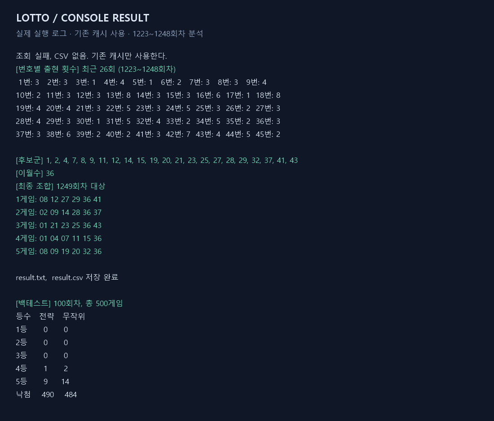

# Lotto — C#으로 만드는 로또 데이터 분석 실습

과거 당첨번호를 수집하고, 최근 출현 빈도로 후보 번호를 골라 조합을 생성하는 .NET 8 콘솔 프로젝트입니다. 데이터 수집부터 캐시, 분석, 결과 저장, 백테스트까지 한 흐름으로 구현했습니다. 핵심 로직은 `LottoCore`로 분리해 콘솔 입출력과 독립적으로 살펴볼 수 있습니다.

이 프로젝트는 통계 처리와 C# 설계 학습을 위한 실험입니다. 과거 출현 빈도나 제외 규칙이 다음 추첨의 당첨 확률을 높인다는 근거를 제공하지 않습니다.

## 결과 화면



위 이미지는 실제 실행 로그를 읽기 쉽게 렌더링한 것입니다. 창을 직접 캡처한 스크린샷은 아닙니다. 온라인 조회가 실패하여 로컬 캐시를 사용했고, 분석 범위는 **1223~1248회차**입니다. 화면의 **1249회차 대상**은 캐시의 마지막 회차에 1을 더한 값이며, 현재 회차를 의미하지 않습니다. 난수 시드를 지정하지 않아 조합과 백테스트 수치는 실행할 때마다 달라질 수 있습니다.

[전체 실행 로그](docs/examples/console-output.txt) · [텍스트 보고서](docs/examples/result.txt) · [CSV 결과](docs/examples/result.csv)

이번 실행에서는 최근 100회차에 대해 전략과 무작위 조합을 각각 500게임씩 비교했습니다.

| 결과 | 전략 | 무작위 |
| --- | ---: | ---: |
| 1등 | 0 | 0 |
| 2등 | 0 | 0 |
| 3등 | 0 | 0 |
| 4등 | 1 | 2 |
| 5등 | 9 | 14 |
| 낙첨 | 490 | 484 |

이 한 번의 결과로 전략의 우수성을 판단할 수는 없습니다. 백테스트는 구현한 규칙이 과거 데이터에서 어떤 결과를 내는지 관찰하는 기능입니다.

## 주요 기능

- 동행복권 조회 주소로 회차별 당첨번호를 가져오고 JSON 캐시에 저장합니다.
- 온라인 조회가 불가능하면 `draws.csv`, 그마저 없으면 기존 JSON 캐시를 사용합니다.
- 최근 26회차의 본번호 출현 횟수를 집계하고 3~4번 나온 번호를 후보군으로 선택합니다.
- 직전 회차 본번호에서 무작위로 이월수 1개를 선택하여 모든 게임에 포함합니다.
- 제외 규칙을 통과한 조합 중 게임 간 번호 중복이 적은 조합을 최대 5게임 생성합니다.
- 분석 결과를 콘솔에 표시하고 `result.txt`, `result.csv`로 저장합니다.
- 최근 최대 100회차를 대상으로 무작위 조합과 당첨 등수를 비교합니다.

## 실행 방법

.NET 8 SDK 이상이 필요합니다. 프로젝트는 `net8.0`을 대상으로 합니다. 별도 NuGet 패키지 의존성은 없습니다.

```powershell
git clone https://github.com/pjbmylove2/Lotto.git
cd Lotto
dotnet build Lotto.sln
dotnet run --project LottoConsole/LottoConsole.csproj
```

입출력 파일 경로는 **프로그램을 실행한 현재 작업 폴더**를 기준으로 합니다. 위 명령을 사용하면 저장소 루트에 캐시와 결과 파일이 생깁니다. 최소 26회차 데이터가 있어야 분석이 진행됩니다. 저장소에는 전체 당첨 데이터 캐시를 포함하지 않습니다.

처음 실행할 때 온라인 조회가 실패하면 작업 폴더에 `draws.csv`를 준비한 뒤 다시 실행합니다. 형식은 다음과 같으며, 첫 줄은 헤더로 건너뜁니다.

```csv
round,date,n1,n2,n3,n4,n5,n6,bonus
1,2002-12-07,10,23,29,33,37,40,16
```

위 한 행은 형식 예시입니다. 실제 분석에는 서로 다른 회차의 유효한 데이터를 26행 이상 준비해야 합니다. CSV는 온라인 조회 불가 시에만 읽으며, 기존 캐시와 회차 번호로 병합합니다. 같은 회차가 있으면 CSV 값이 우선합니다. `Ctrl+C`로 작업을 취소할 수 있습니다.

## 코드 구조

```text
Lotto.sln
├─ LottoConsole/
│  └─ Program.cs            # 수집 → 분석 → 출력 → 백테스트 실행
├─ LottoCore/
│  ├─ AnalysisOptions.cs    # 분석과 생성 설정
│  ├─ Draw.cs               # 회차, 날짜, 본번호, 보너스 번호 모델
│  ├─ DhLotteryApiSource.cs # HTTP 조회 및 응답 검증
│  ├─ DrawCache.cs          # JSON 캐시 읽기/쓰기
│  ├─ CsvDrawSource.cs      # CSV 입력
│  ├─ DrawRepository.cs     # 증분 수집 및 CSV 병합
│  ├─ FrequencyAnalyzer.cs # 빈도 집계, 후보군 및 이월수 선택
│  ├─ ComboGenerator.cs    # 규칙 적용 및 중복 분산
│  ├─ LottoRules.cs        # 조합 제외와 당첨 등수 판정
│  ├─ ReportBuilder.cs     # 텍스트/CSV 보고서
│  └─ BacktestResult.cs    # Backtester와 비교 결과 모델
└─ docs/                   # 실행 예시와 결과 이미지
```

## 핵심 코드 설명

### 1. 최근 데이터로 후보군 만들기

[`FrequencyAnalyzer`](LottoCore/FrequencyAnalyzer.cs)는 회차 순으로 정렬한 뒤 최근 N개를 선택합니다. 보너스 번호는 빈도 집계에서 제외합니다.

```csharp
List<Draw> recent = history.OrderBy(d => d.Round)
                           .TakeLast(opt.RecentRounds).ToList();

int[] counts = new int[46];
foreach (Draw d in recent)
    foreach (int n in d.Numbers)
        counts[n]++;

List<int> candidates = Enumerable.Range(1, 45)
    .Where(n => counts[n] >= opt.MinCount && counts[n] <= opt.MaxCount)
    .Except(carry)
    .ToList();
```

`counts[번호]`로 빈도를 바로 조회합니다. 직전 회차에서 선택한 이월수는 후보군에서 빼서 같은 게임 안에서 중복되지 않게 합니다. 여기서 이월수는 다음 회차에도 나온다고 예측한 값이 아니라, 이전 회차 번호를 조합에 포함시키는 실험 규칙입니다.

### 2. 조합 필터링과 게임 간 분산

[`ComboGenerator`](LottoCore/ComboGenerator.cs)는 이월수와 후보 번호를 합쳐 6개 번호를 만들고 정렬합니다. [`LottoRules.IsExcluded`](LottoCore/LottoRules.cs)는 다음 조합을 제외합니다.

- 연속된 번호가 3개 이상인 조합
- 끝자리가 같은 번호가 3개 이상인 조합
- 6개 번호가 모두 31 이하인 조합

게임 하나당 최대 2,000번 시도하며, 이전 게임과 완전히 같은 조합은 제외합니다. 통과한 조합의 점수는 다음과 같습니다.

```csharp
int score = combo.Sum(n => used[n]);
```

`used[n]`은 앞서 만든 게임에 번호 n이 쓰인 횟수입니다. 점수가 낮은 조합을 선택하여 번호를 분산합니다. 이월수는 모든 게임에 공통으로 들어갑니다. 조건을 충족하지 못하면 설정한 게임 수보다 적게 생성될 수 있고, 후보군 자체가 부족하면 분석 오류를 출력합니다.

### 3. 미래 데이터를 사용하지 않는 백테스트

[`Backtester`](LottoCore/BacktestResult.cs)는 각 대상 회차의 **직전까지의 데이터**만 분석에 사용합니다.

```csharp
List<Draw> history = sorted.GetRange(0, i);
Draw target = sorted[i];
```

이렇게 만든 전략 조합과 같은 개수의 무작위 조합을 실제 당첨번호와 비교합니다. 등수 판정은 본번호 일치 개수와 보너스 일치 여부로 처리합니다. 조합 생성이 불가능한 회차는 건너뛰므로 실제 집계 회차와 게임 수를 함께 확인해야 합니다. 백테스트 표는 콘솔에만 출력되고 `result.txt`와 `result.csv`에는 저장되지 않습니다.

### 4. 수집과 캐시 분리

[`DrawRepository`](LottoCore/DrawRepository.cs)는 캐시의 마지막 회차 다음부터 순차적으로 조회합니다. 조회 도중 취소되거나 오류가 나더라도 새로 받은 데이터는 `finally`에서 저장합니다. 조회 응답에는 요청한 회차가 맞는지, 번호가 1~45 범위인지, 중복이 없는지 등을 검사합니다. 조회 주소는 비공식이므로 서비스 변경이나 점검에 따라 실패할 수 있습니다. CSV 입력은 단순 파서이므로 유효한 형식과 번호를 준비해야 합니다.

## 설정 바꾸기

[`Program.cs`](LottoConsole/Program.cs)의 `new AnalysisOptions()`에 값을 지정합니다. 명령줄 옵션 파서는 구현되어 있지 않습니다.

```csharp
var opt = new AnalysisOptions
{
    RecentRounds = 26,
    MinCount = 3,
    MaxCount = 4,
    CarryOverCount = 1,
    GameCount = 5,
    Seed = 42
};
```

| 설정 | 기본값 | 의미 |
| --- | --- | --- |
| `RecentRounds` | `26` | 분석할 최근 회차 수 |
| `MinCount` / `MaxCount` | `3` / `4` | 후보 번호의 출현 횟수 범위 |
| `CarryOverCount` | `1` | 직전 회차에서 고를 이월수 개수 |
| `GameCount` | `5` | 생성할 최대 게임 수 |
| `Seed` | `null` | 난수 시드. 동일 데이터·설정·실행 환경에서 결과 재현에 사용 |
| `RequestDelayMs` | `10` | 회차 조회 간 대기 시간(ms) |
| `CachePath` | `draws.json` | JSON 캐시 경로 |

백테스트 회차 수는 `Program.cs`의 `Backtester.Run(draws, opt, 100, ...)`에서 변경할 수 있습니다.

## 확인한 내용

- `dotnet build Lotto.sln --no-restore`: 경고 0개, 오류 0개
- 기존 JSON 캐시를 사용한 콘솔 실행: 빈도 분석, 5게임 생성, TXT/CSV 저장 완료
- 최근 100회차 백테스트: 전략과 무작위 각각 500게임 집계 완료

온라인 최신 데이터 수집 성공 여부는 이번 검증 범위에 포함되지 않습니다. 실행 예시는 기존 캐시를 사용한 결과입니다.
